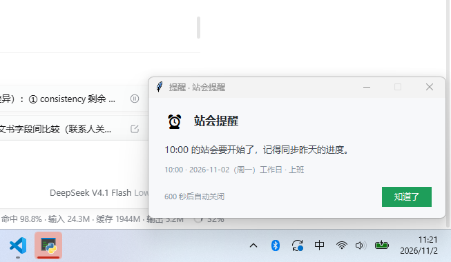

# 工作日提醒（WorkdayAlarm）

[](https://github.com/2281884343/workdayalarm/actions/workflows/ci.yml)
[](LICENSE)

一款常驻 Windows 系统托盘的定时提醒小工具：**按国务院发布的法定节假日与调休安排判定“真实工作日”**，只在国内真正上班的日子提醒你，普通周末、法定节假日自动跳过，**周末补班日照常提醒**。

传统闹钟只会“周一到周五响”，遇到五一调休、国庆补班、春节长假就全乱；工作日提醒内置节假日数据，一年只设置一次，之后每年的调休都自动适配。

- 离线可用，节假日数据本地内置；只有「每年 12 月 30 日后缺少下一年数据」或你手动点「更新节假日数据」时才访问一次 PyPI
- 单文件 exe，绿色免安装，无广告、无遥测、不上传任何数据
- 纯 Python 标准库实现（托盘 ctypes + 弹窗 tkinter），常驻内存约十几 MB

**直接下载**：[`dist/WorkdayAlarm.exe`](dist/WorkdayAlarm.exe)（12.9 MB，Windows 10/11，双击即用，无需安装 Python）

> English: WorkdayAlarm is a tiny Windows tray reminder that only fires on **real working days in China** — it follows the State Council's official holiday and makeup-workday (调休) calendar, so it stays silent on weekends/long holidays and still rings on makeup Saturdays. Single-file exe, offline, no telemetry, MIT licensed.



## 功能特性

| 能力 | 说明 |
| --- | --- |
| 真实工作日判定 | 区分普通工作日、法定节假日、周末休息、**周末补班工作日**，数据来源见下文 |
| 多组定时提醒 | 可配置任意多条提醒（时间 / 标题 / 内容 / 是否启用），各自可覆盖提醒方式与提示音 |
| 一天一次 | 每条提醒当天最多触发一次，重启程序、跨零点都不会重复弹窗 |
| 补偿窗口 | 电脑休眠 / 关机错过时间点，唤醒后若误差在窗口内（默认 30 分钟）仍会补发；超出则记为“今日已错过”，不再骚扰 |
| 两种提醒方式 | Windows 系统通知（可被专注助手收纳）或**置顶弹窗**（右下角堆叠、倒计时自动关闭、`知道了` 按钮、**不抢键盘焦点**，不打断正在输入的内容），也可按提醒单独指定 |
| 提示音 | 系统提示音 / 静音 / 指定 wav 文件 |
| 托盘常驻 | 托盘图标显示状态（绿色=提醒开启，灰色=已暂停），右键菜单可开关、测试、打开配置、重载、查看日志 |
| 开机自启 | 写入 HKCU 的 `Run` 项，托盘菜单一键切换，不需要管理员权限 |
| 年度数据更新 | 每年 12/30 起自动联网补齐下一年放假安排（成功即时生效、失败只提示一次）；也可托盘菜单手动更新，或关掉自动更新后完全离线手动生成 |
| 容错 | 配置文件写坏自动备份为 `.broken` 并回落默认配置；资源管理器重启后图标自动重挂；单实例保护，不会开两个 |

## 快速开始

### 方式一：使用打包好的 exe（推荐）

1. 下载 [`WorkdayAlarm.exe`](dist/WorkdayAlarm.exe)，放到任意目录（例如 `D:\Tools\WorkdayAlarm\`），双击运行；
2. 首次运行会在 exe 同目录生成 `config.json`、`state.json`、`logs/`；
3. 右键托盘图标 → **打开配置文件**，改好时间后 → **重新加载配置**。

### 方式二：从源码运行

```bash
pip install chinesecalendar        # 仅在需要重新生成节假日数据时使用
python main.py                     # 启动托盘程序
python main.py --check             # 查看最近 14 天的工作日判定
python main.py --test              # 环境自检：Tk、托盘、数据覆盖年份
python main.py --config 某配置.json # 使用指定配置文件
```

要求 Windows + Python 3.9+（开发环境为 3.14）；运行时不依赖任何第三方库。

## 目录结构

```
alarm/
  app.py          主循环：Tk 收消息、调度器、托盘、弹窗装配
  scheduler.py    触发判定（只挑工作日、每天一次、补偿窗口）
  workday.py      工作日判定 + 数据源合并（含缺年兜底）
  config.py       配置解析/校验/原子写
  state.py        已触发记录（落盘，防重复）
  notifier.py     系统通知 / 置顶弹窗 / 提示音
  tray.py         ctypes 实现的托盘图标与菜单
  icon.py         运行时生成 ICO（无需图片资源）
  autostart.py    开机自启（注册表 Run 项）
  dataupdate.py   年度数据更新（需要时从 PyPI 取最新 chinesecalendar 数据）
  paths.py        目录解析（exe 目录优先，不可写则回落 %APPDATA%）
  logging_setup.py 滚动日志
data/holidays.json  内置节假日数据（随包发布，可直接替换）
tools/gen_holidays.py  由 chinesecalendar 生成/更新 holidays.json
tools/build.py         PyInstaller 打包脚本
tests/                 单元测试（56 个用例）
main.py                入口（含命令行子命令与单实例）
```

## 配置说明

配置文件默认位于 exe 同目录的 `config.json`（源码运行时为项目根目录）。全部字段如下：

| 字段 | 默认值 | 说明 |
| --- | --- | --- |
| `enabled` | `true` | 全局开关，`false` 时任何提醒都不触发 |
| `poll_interval_seconds` | `10` | 轮询间隔（秒），建议 10–60；到点判定精确到分钟 |
| `catch_up_minutes` | `30` | 补偿窗口（分钟），休眠唤醒后补发的最大延迟 |
| `notification_mode` | `"toast"` | 全局提醒方式：`toast` 系统通知 / `popup` 置顶弹窗 |
| `popup_timeout_seconds` | `30` | 置顶弹窗自动关闭秒数，`0` 表示不自动关闭 |
| `notification_timeout_seconds` | `10` | 系统通知停留秒数 |
| `sound` | `"default"` | `default` 系统提示音 / `none` 静音 / wav 绝对路径 |
| `autostart` | `false` | 是否开机自启（托盘菜单切换后会自动写回） |
| `auto_update_data` | `true` | 每年 12 月 30 日后若缺少下一年数据，自动联网补齐（见下文「年度数据更新」） |
| `log_level` | `"INFO"` | `DEBUG` / `INFO` / `WARNING` / `ERROR` |
| `unknown_year_policy` | `"weekday"` | 当年数据缺失时的兜底：`weekday` 周一至周五上班，`holiday` 全部按休息 |
| `reminders` | 3 条示例 | 提醒列表，见下 |

每条提醒：

| 字段 | 说明 |
| --- | --- |
| `id` | 唯一标识（用于去重与状态记录），不同提醒不能重复 |
| `time` | `HH:MM` 24 小时制，必须补零 |
| `title` / `message` | 通知标题与正文 |
| `enabled` | 该条是否启用 |
| `mode` | `"toast"` / `"popup"` / `null`（跟随全局） |
| `sound` | 同全局 `sound`，`null` 表示跟随全局 |

说明：

- `config.json` 里以 `_` 开头的键（如 `_comment`、`_fields`）只作注释，程序保存时会原样保留；
- 改完配置**不必重启**：托盘菜单 →「重新加载配置」即可，界面和调度立即生效；
- 配置有硬错误（例如时间格式写错）会弹窗提示并跳过该条；只是“提醒列表为空”这类软提示只在托盘气泡里提示一次。

## 托盘菜单

| 菜单项 | 作用 |
| --- | --- |
| 首行灰色文字 | 今日判定结果，例如「2026-11-02（周一）工作日 → 上班 · 内置数据」 |
| 启用提醒 | 勾选项，快速全局开关（会写回配置文件） |
| 立即测试 | 按当前配置立刻发一条测试提醒，用来验证通知/弹窗是否可见 |
| 今日状态 | 弹窗显示今日判定、下一个工作日、后续提醒时间 |
| 打开配置文件 | 用系统默认编辑器打开 `config.json` |
| 重新加载 | 重新读取配置与节假日数据（新增年份的数据也能即时生效） |
| 更新节假日数据 | 联网从 PyPI 补齐缺失年份的放假安排，成功后立即生效 |
| 开机自启 | 勾选项，写入/移除注册表 Run 项 |
| 查看日志 | 打开 `logs/workday_alarm.log` |
| 关于 | 版本与数据覆盖年份 |
| 退出 | 退出程序 |

双击托盘图标相当于「立即测试」。

## 工作日判定与数据来源

判定逻辑：只有当日为**真实工作日**才检查提醒。类别分为 `工作日 / 调休上班 / 法定节假日 / 周末休息 / 未知`。

数据源按“年”逐个合并，命中即用：

1. `holidays.local.json`（程序目录，用户自建，优先）：可只写某几天，与其它数据按日期合并，用来修正临时通知；
2. `<程序目录>/data/holidays.json`（自动/手动更新写入的数据）；
3. `data/holidays.json`（随包发布的内置数据，当前覆盖 **2024–2026** 年）；
4. `chinesecalendar` 包（仅源码运行且已安装时）；
5. 以上都没有覆盖到的年份 → 按 `unknown_year_policy` 兜底，并在日志里给出 WARNING 提醒你更新数据。

> 程序目录不可写（例如放在 Program Files）时，第 2 项会写到 `%APPDATA%\WorkdayAlarm\data\holidays.json`。

### 年度数据更新（自动 + 手动）

新一年的放假通知一般在前一年 11 月左右发布，程序默认在**每年 12 月 30 日之后**自动检查：

- 若缺少下一年的数据，会在后台线程里从 PyPI 取最新版 `chinesecalendar` 的放假数据，写入
  `<程序目录>/data/holidays.json`，并在托盘气泡里告知结果；
- 更新成功会立即生效，不需要重启；
- 如果那时数据还没发布，只发一条「更新失败」提示（不会反复重试，每天最多一次尝试），
  之后每天 12/30 起仍会再试一次；
- 也可以随时右键托盘 →「更新节假日数据」手动触发，或关掉 `auto_update_data` 改为纯手动。

命令行更新（可选）：

```bash
python main.py --update-data                # 补当前缺失的年份
python main.py --update-data --years 2027   # 指定年份，可写 2026,2027
```

完全离线的做法（不想让程序联网时）：关掉 `auto_update_data`，在自己电脑上执行

```bash
pip install -U chinesecalendar     # 升级到包含新一年数据的版本
python tools/gen_holidays.py --years 2027 --out data/holidays.json
```

生成脚本会保留已有年份、追加新一年，并打印核对信息（节假日天数、补班日列表）。更新后建议交叉校验：

```bash
python main.py --check 2027-01-01 --days 30
```

临时性调整（例如某地单独放假）不用改内置数据，直接在同目录建 `holidays.local.json`：

```json
{
  "years": {
    "2027": {
      "holidays": { "2027-01-04": "临时放假" },
      "workdays": { "2027-01-09": "调休上班" }
    }
  }
}
```

## 命令行

| 命令 | 说明 |
| --- | --- |
| `main.py` | 启动托盘程序 |
| `main.py --check [日期] [--days N]` | 打印从该日期起 N 天（默认 14）的逐日判定与下一个工作日 |
| `main.py --test` | 自检：配置/状态/日志路径、数据覆盖年份、今日判定、Tk 与托盘可用性 |
| `main.py --config PATH` | 指定配置文件 |
| `main.py --home PATH` | 指定数据目录（等价于设置环境变量 `WORKDAY_ALARM_HOME`） |
| `main.py --update-data [--years 2027]` | 联网更新节假日数据（不指定年份则补当前缺失的年份） |
| `main.py --no-tray` | 不创建托盘图标（调试用） |
| `main.py --version` | 版本号 |

## 打包

```bash
python tools/build.py            # 生成 dist/WorkdayAlarm.exe（单文件、无控制台、带图标）
python tools/build.py --clean    # 先清理 build/dist
python tools/build.py --onedir   # 打成目录（启动更快，便于排查）
python tools/build.py --console  # 保留控制台窗口，便于看报错
```

脚本会自动生成 `assets/app.ico`（代码绘制）、检查 `data/holidays.json` 是否存在、并用 `--add-data` 把数据目录塞进包里；`chinese_calendar`/numpy/pandas/PIL 会被排除，因此 exe 体积只有十几 MB。

## 运行文件位置

| 文件 | 位置 |
| --- | --- |
| 配置 | `<home>/config.json` |
| 状态 | `<home>/state.json`（记录每天已触发的提醒，保留 14 天） |
| 日志 | `<home>/logs/workday_alarm.log`（1MB 滚动，保留 3 份） |
| 内置数据 | `data/holidays.json`（随包发布；手动/自动更新后会在 `<home>/data/holidays.json` 生成一份补充数据） |

`<home>` 默认是 exe 所在目录；若该目录不可写（例如放在 `C:\Program Files`），自动回落到 `%APPDATA%\WorkdayAlarm`。可用环境变量 `WORKDAY_ALARM_HOME` 强制指定。

## 常见问题

**Q：为什么今天没提醒？**
先看托盘菜单首行的今日判定；若显示节假日/周末，说明判定正确。再确认：全局「启用提醒」是否打开、该条 `enabled` 是否为 `true`、时间是否已过且超出补偿窗口（日志里会写“已错过 N 分钟（补偿窗口 30 分钟）”）。

**Q：系统通知看不到？**
Windows 设置 → 系统 → 通知，确认「通知」开启、且未处于“专注助手/免打扰”；exe 未签名时通知标题可能显示为 Python 或未知应用。更醒目的方式是 `notification_mode` 改成 `popup`。

**Q：休眠唤醒后还会补提醒吗？**
会。唤醒后若当前时间距提醒时间在补偿窗口内（默认 30 分钟，取 `max(catch_up_minutes, 轮询间隔+5)`）就补发一次；否则只记日志不弹窗，避免开机就弹一堆过期提醒。

**Q：跨零点、程序重启会不会重复弹？**
不会。已触发记录写在 `state.json`，同一天同一 `id` 只触发一次；跨天后自动进入新的一天。

**Q：明年没有数据怎么办？**
每年 12 月 30 日之后程序会自动联网补齐（见「年度数据更新」）；若自动更新失败，可右键托盘 →「更新节假日数据」手动重试，或用 `python main.py --update-data`。在这之前仍会按 `unknown_year_policy` 兜底（默认周一到周五上班）并在日志里 WARNING。

**Q：开机自启没生效？**
检查注册表 `HKEY_CURRENT_USER\Software\Microsoft\Windows\CurrentVersion\Run` 下是否有 `WorkdayAlarm` 值；以管理员身份运行时写入的是管理员账户的 HKCU，与普通登录不是同一个账户时会不生效。

## 测试

```bash
python -m unittest discover -s tests -v
```

覆盖节假日/补班判定、缓存与年度兜底、配置校验与保存往返、调度触发规则（每天一次、补偿窗口、跨国庆长假的下一次提醒）、年度数据来源优先级、年度数据更新的解析与合并等 56 个用例。

## 隐私

程序平时不联网、不上报任何数据；只有两种情况会访问网络，且仅访问 PyPI（`pypi.org`）下载 `chinesecalendar` 的官方数据包：
① 每年 12 月 30 日之后缺少下一年数据时（可通过 `auto_update_data: false` 关闭）；
② 你手动点托盘菜单「更新节假日数据」或执行 `--update-data`。

配置、状态、日志都只写在本机目录内。删除程序目录即可完全卸载（若开过开机自启，先在托盘菜单里关掉）。

## 开源协议

[MIT](LICENSE) © 2026 WorkdayAlarm contributors

节假日数据来自 [chinesecalendar](https://github.com/LKI/chinese-calendar)（MIT），判定规则以中国政府发布的放假安排为准。欢迎提 Issue / PR，尤其欢迎每年 12 月新一年安排公布后帮忙核对数据。
